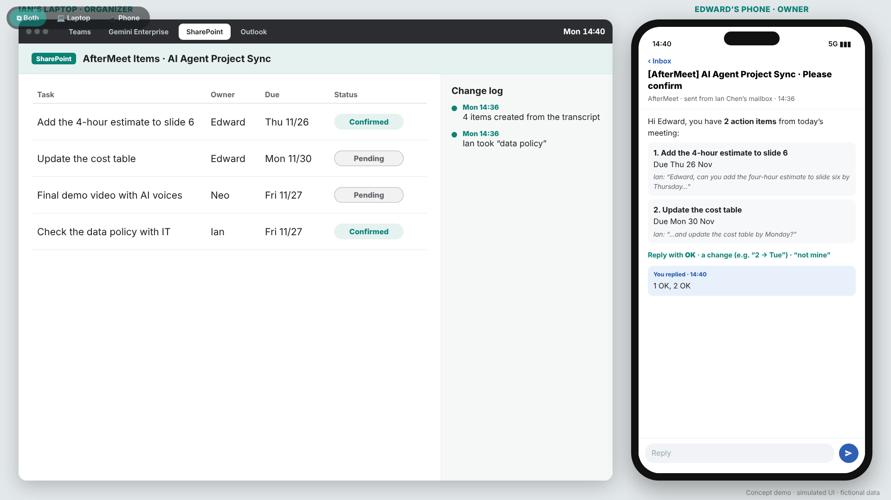

# AfterMeet — Demo Player（Level 1）

**AfterMeet — An AI Agent that turns meetings into finished work**

這是「錄影用」的概念 demo：所有畫面、台詞和信件都寫死在腳本裡，搭配 AI 語音播放，模擬 AfterMeet Level 1（Gemini Enterprise Workflow Builder）的實際樣子：

1. Teams 會議結束，逐字稿產生
2. Ian（主辦人）在 Gemini Enterprise 輸入 `@AfterMeet` 並附上逐字稿，指派沒有負責人的項目，按下核准
3. SharePoint 清單出現 4 個項目
4. Edward 的手機收到確認信，回覆「1 OK, 2 OK」，清單更新
5. 週三收到彙整信，Edward 回報卡關，Ian 的 Outlook 收到通知
6. 週五項目完成，Ian 的草稿匣出現下週一例會的議程草稿



## 怎麼播放

用 Chrome 或 Edge 打開 `index.html`，按 **▶ Play (auto)**。

| 按鍵 | 功能 |
|---|---|
| Space | 暫停／繼續 |
| → | 下一步（Step mode） |
| R | 重新開始 |
| 1 / 2 / 3 | 左右並排／只看筆電／只看手機 |
| H | 顯示目前步驟（HUD） |

左上角的切換按鈕在滑鼠停止 2.5 秒後會自動隱藏，錄影時不會入鏡。
網址後面加 `?step=40` 可以直接跳到第 40 步，方便截圖和檢查修改結果。

## 檔案結構

```
index.html               播放器（引擎和畫面），一般不需要修改
content/config.js        名稱、標籤、手機裡原有的信件、結尾畫面
content/people.js        與會者（名字、職稱、顏色、AI 語音）
content/script.js        整段 demo 的腳本，由上往下逐步執行
audio/                   AI 語音檔（audio/<id>.mp3）
tools/generate_audio.py  依照 script.js 產生語音檔
```

## 要改什麼，去哪裡改

| 想改的東西 | 檔案 | 怎麼改 |
|---|---|---|
| 會議名稱、清單名稱、畫面上方標籤 | `config.js` | `meetingTitle`、`listName`、`laptopLabel`、`phoneLabel` |
| 手機收件匣裡原本就有的信 | `config.js` | `phoneInbox` |
| 結尾畫面 | `config.js` | `endCard` |
| 與會者、聲音 | `people.js` | 每人一行；`tts.edge` 是 edge-tts 的聲音名稱 |
| 會議台詞 | `script.js` | `speak` 的 `text`，改完要重新產生語音 |
| Gemini Enterprise 抽出的項目 | `script.js` | `ge_items` 的 `items` |
| SharePoint 清單和狀態變化 | `script.js` | `sp_row`、`sp_status`、`sp_log` |
| Edward 收到的信和他的回覆 | `script.js` | `ph_mail`（`body` 可以寫 HTML）、`ph_reply` |
| Ian 電腦上的通知信和議程草稿 | `script.js` | `ol_mail` |
| 時間跳轉畫面 | `script.js` | `skip` |

## Step reference（script.js 的步驟類型）

**共用**

| type | 參數 | 說明 |
|---|---|---|
| `left` | `to: "teams" \| "gemini" \| "sharepoint" \| "outlook"` | 切換筆電畫面，上方分頁同步亮起 |
| `clock` | `t: "Mon 14:40"` | 更新筆電和手機上的時間 |
| `skip` | `big`, `small`, `clock` | 全螢幕時間跳轉畫面 |
| `toast` | `text`, `ms` | 下方黑色提示 |
| `notify` | `who`, `text` | 上方跳出「某人做了某事」（用來表示不在畫面上的人的動作） |
| `wait` | `ms` | 停一下 |
| `endcard` | | 結尾畫面 |

**Teams**

| type | 參數 | 說明 |
|---|---|---|
| `join` / `leave` | `who` | 與會者加入／離開 |
| `speak` | `id`, `who`, `text` | 說話（字幕加語音）。**整個步驟要寫在同一行**，語音工具才找得到 |
| `chat_sys` | `text` | 會議聊天室的灰色系統訊息 |

**Gemini Enterprise**

| type | 參數 | 說明 |
|---|---|---|
| `ge_user` | `text`, `file` | Ian 輸入的訊息，`file` 會顯示成附件 |
| `ge_typing` | `ms` | AfterMeet 正在處理 |
| `ge_items` | `intro`, `items: [{task, owner, due, quote}]` | 抽出的項目清單；`owner` 留空會顯示橘色「No owner」 |
| `ge_ask` | `id`, `question`, `options` | 「Needs your input」卡片 |
| `ge_approve` | `id`, `lines` | 「Approval needed」卡片（Approve／Edit） |
| `ge_click` | `id`, `option` | 游標移過去按下某個按鈕 |
| `ge_agent` | `html` | AfterMeet 的一般回覆 |

**SharePoint 清單**

| type | 參數 | 說明 |
|---|---|---|
| `sp_row` | `id`, `task`, `owner`, `due`, `status` | 新增一列 |
| `sp_status` | `id`, `status`，可選 `owner`, `due` | 更新狀態，該列會閃一下 |
| `sp_log` | `t`, `text`，可選 `warn: true` | 右側變更紀錄 |

狀態可用：`Pending`、`Confirmed`、`In progress`、`Changed`、`Needs owner`、`Blocked`、`Done`。

**Outlook**

| type | 參數 | 說明 |
|---|---|---|
| `ol_mail` | `folder: "Inbox" \| "Drafts"`, `from`, `subject`, `body` | 筆電上 Ian 的 Outlook 顯示一封信 |
| `ph_mail` | `id`, `subject`, `preview`, `body` | Edward 的手機收到一封信（跳出通知、手機震動） |
| `ph_open` | `id` | 打開那封信 |
| `ph_reply` | `text` | 逐字打出回覆並送出 |
| `ph_back` | | 回到收件匣 |

## 範例：多一個項目，讓 Edward 改期限

```js
// ge_items 的 items 裡加一筆
{ task: "Update the customer forecast", owner: "Edward", due: "Wed 11/25", quote: "Edward, the forecast by Wednesday?" },
// SharePoint
{ type: "sp_row", id: "a5", task: "Update the customer forecast", owner: "Edward", due: "Wed 11/25", status: "Pending" },
// Edward 的回覆
{ type: "ph_reply", text: "1 OK, 2 OK, 3 → Fri" },
{ type: "sp_status", id: "a5", status: "Changed", due: "Fri 11/27" },
{ type: "sp_log", t: "Mon 14:40", text: "Edward moved “forecast” to Fri" },
```

## AI 語音

每個 `speak` 步驟會播放 `audio/<id>.mp3`；找不到檔案時改用瀏覽器內建語音（只是暫代）。

```bash
pip install edge-tts
python tools/generate_audio.py            # 產生所有缺少的語音
python tools/generate_audio.py --force    # 改過台詞後全部重新產生
python tools/generate_audio.py --only 04_neo --force   # 只重做一句
```

聲音設定在 `people.js`：Ian 是 `en-US-AvaNeural`（女聲），Edward 是 `en-US-AndrewNeural`，Neo 是 `en-US-BrianNeural`。

## 錄影建議

- 瀏覽器全螢幕（F11），用 OBS 或 Windows 的 Xbox Game Bar 錄影
- 先用 Step mode 跑一遍確認內容，再用 auto 模式正式錄
- 錄影時把滑鼠移到角落不要動
- 整段大約 1.5–2 分鐘；想調整節奏就改 `wait` 和 `skip` 的 `ms`

所有資料皆為虛構，畫面為模擬 UI，不代表實際產品介面。
